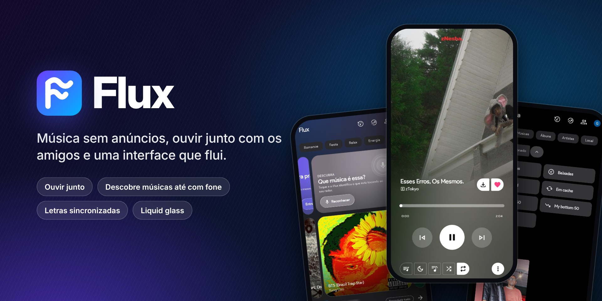
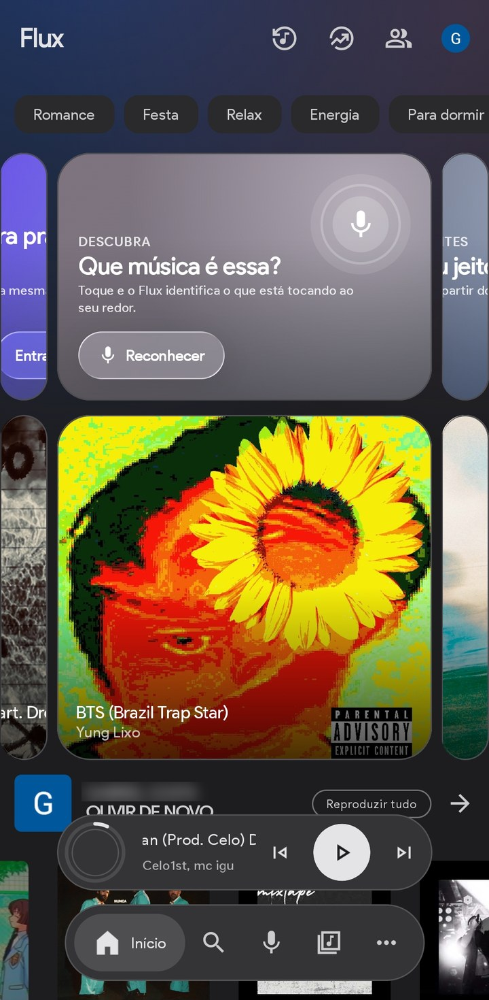
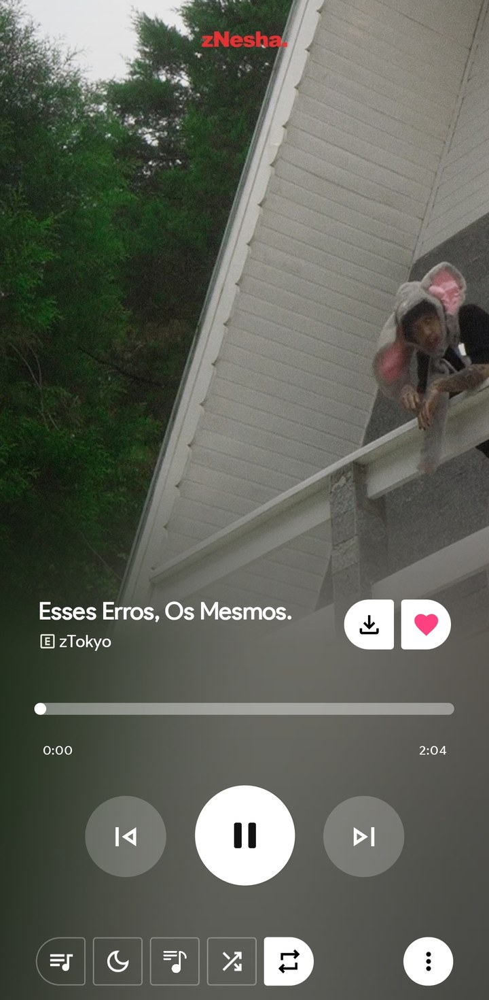
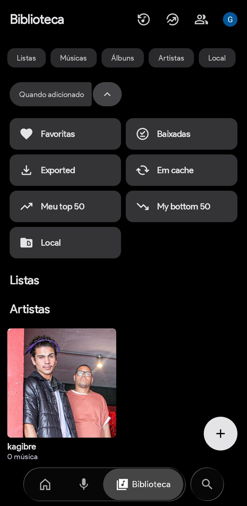

<div align="center">



<br>


# Flux

**Música sem anúncios, ouvir junto com os amigos e uma interface que flui.**

[](https://github.com/Notgabxx/Echo-Music-Gabxversion-/releases)
[](LICENSE)


</div>

---

## Por que o Flux

O Flux é um app de música para Android feito para quem quer ouvir sem interrupções e com um visual caprichado. Ele toca o catálogo do YouTube Music sem anúncios, baixa músicas para ouvir offline e tem recursos que outros players não têm, como ouvir em sincronia com os amigos.

<table>
  <tr>
    <td align="center" width="33%"></td>
    <td align="center" width="33%"></td>
    <td align="center" width="33%"></td>
  </tr>
  <tr>
    <td align="center"><b>Início</b></td>
    <td align="center"><b>Player</b></td>
    <td align="center"><b>Biblioteca</b></td>
  </tr>
</table>

## Destaques

| | |
| :-- | :-- |
| 🎧 **Ouvir junto** | Crie uma sala e escute a mesma música, no mesmo segundo, com quem você quiser. Dá para entrar com um código direto da tela inicial. |
| 🔎 **Descobrir música** | Identifica a música que está tocando ao seu redor ou em outros apps do celular (vídeos, reels, jogos), até com fone de ouvido. Um toque e ela abre no Flux. |
| ▶️ **Player vivo** | O botão de play flui e pulsa no ritmo da música, a capa ganha uma aura que reage a graves, médios e agudos, e o mini player vira o player completo com uma transição contínua. |
| 🎨 **Cores da capa** | O tema acompanha a música que está tocando, com contraste ajustado automaticamente para o texto continuar legível. |
| 🧊 **Liquid glass** | Barras e botões de vidro fosco que refletem o conteúdo atrás deles. |
| 📝 **Letras sincronizadas** | Letras palavra por palavra, de várias fontes, com tradução opcional. |
| ⬇️ **Offline** | Baixe músicas, álbuns e playlists para ouvir sem internet. |
| ✨ **Mixes inteligentes** | Playlists montadas a partir do que você mais escuta. |

Os efeitos visuais podem ser ligados ou desligados em **Configurações → Aparência**.

## Como instalar

1. Abra a página de [**Releases**](https://github.com/Notgabxx/Echo-Music-Gabxversion-/releases) no celular.
2. Baixe o arquivo `Flux-buildN.apk` da versão mais recente.
3. Abra o arquivo e permita a instalação de fontes desconhecidas quando o Android pedir.

> [!NOTE]
> Por enquanto, cada build é assinada com uma chave diferente. Se o Android disser que o app não pode ser atualizado, desinstale a versão anterior antes de instalar a nova.

## Compilação

Cada push na branch `main` dispara o workflow [`flux-apk.yml`](.github/workflows/flux-apk.yml), que gera um APK otimizado e o publica em **Releases**. Para compilar no seu computador, veja o [SETUP.md](SETUP.md):

```bash
./gradlew :app:assembleUniversalGmsRelease
```

## Contribuindo

Sugestões, relatos de bugs e pull requests são bem-vindos. Antes de começar, leia o [CONTRIBUTING.md](CONTRIBUTING.md) e o [código de conduta](CODE_OF_CONDUCT.md). Para falhas de segurança, siga o [SECURITY.md](SECURITY.md).

## Privacidade

O Flux não tem contas, anúncios nem rastreamento. Suas músicas, playlists e configurações ficam no seu aparelho. Veja os detalhes na [política de privacidade](PRIVACY_POLICY.md).

## Créditos

O Flux é um fork do **[Echo Music](https://github.com/EchoMusicApp/Echo-Music)** e é distribuído sob a mesma licença, a **GNU GPL v3.0** (veja [LICENSE](LICENSE)). O código-fonte completo está neste repositório.

Projetos open source que também fazem parte desta base:

| Projeto | Contribuição |
| :------ | :----------- |
| **[Echo Music](https://github.com/EchoMusicApp/Echo-Music)** | Base do aplicativo (fork) |
| **[Metrolist](https://github.com/MetrolistGroup/Metrolist)** & **[Vivi Music](https://github.com/vivizzz007/vivi-music)** | Referência de arquitetura e servidor comunitário do Ouvir junto |
| **[ArchiveTune](https://github.com/koiverse/ArchiveTune)** | Inspiração de interface Material You |
| **[Better Lyrics](https://better-lyrics.boidu.dev/)** | Aprimoramento e sincronização de letras |
| **[SimpMusic](https://github.com/maxrave-dev/SimpMusic)** | Referência de implementação de letras |
| **[Music Recognizer](https://github.com/aleksey-saenko/MusicRecognizer)** | Reconhecimento de áudio |
| **[BravePipe](https://github.com/bravepipeproject/BravePipe)** | Decriptação e mecanismo de reprodução reserva |
| **[Kyant0/backdrop](https://github.com/Kyant0/backdrop)** | Efeito liquid glass (Apache 2.0) |

## Aviso legal

O Flux é um projeto open source, gratuito e sem fins comerciais. Ele não é afiliado ao YouTube, ao Google nem a nenhum serviço de streaming. O app não hospeda nem distribui conteúdo protegido: o áudio e o vídeo vêm dos servidores públicos do YouTube e do YouTube Music e pertencem aos respectivos donos. Para apoiar os artistas, considere assinar os serviços oficiais.

O software é fornecido "como está", sem garantia de qualquer tipo. Cada pessoa é responsável por usar o app de acordo com as leis locais e os termos de serviço das plataformas acessadas.

<div align="center">
  <sub>Licenciado sob <a href="LICENSE">GPL-3.0</a></sub>
</div>
